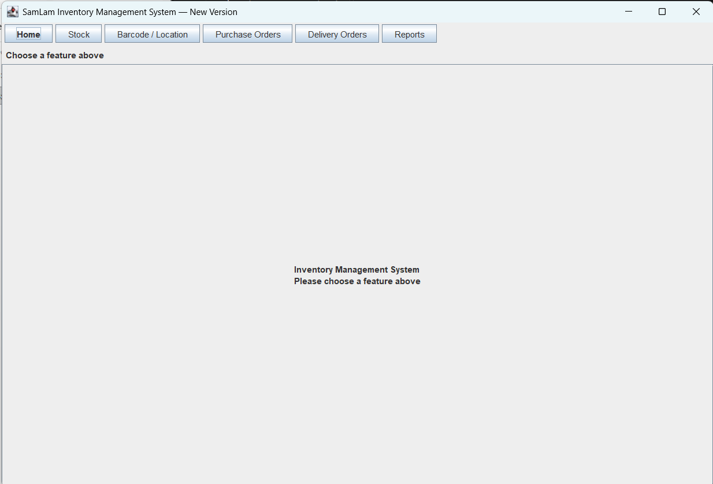
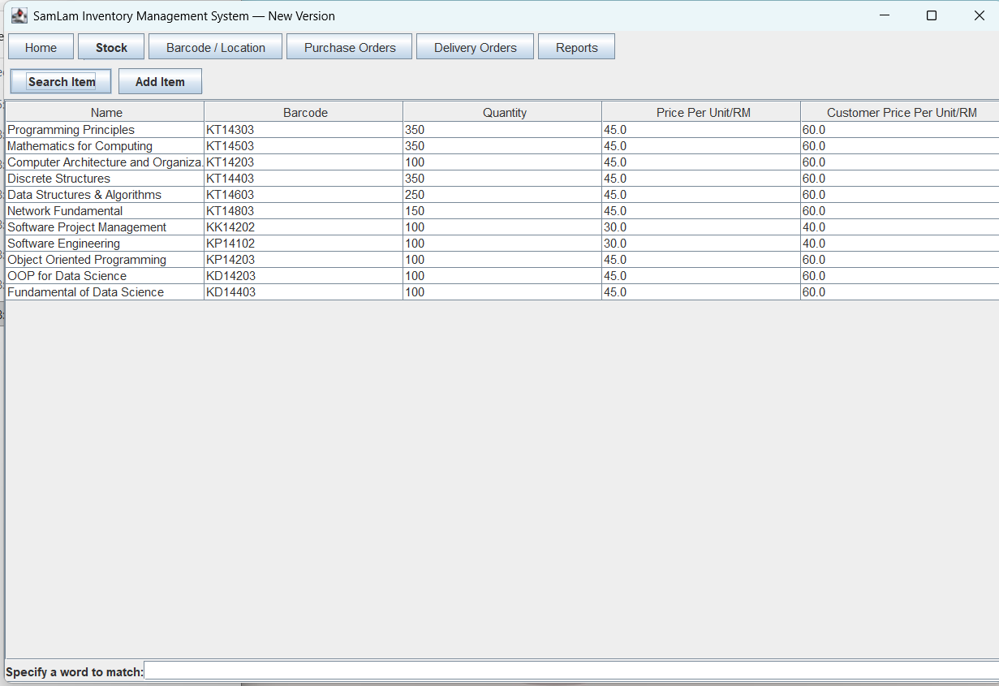
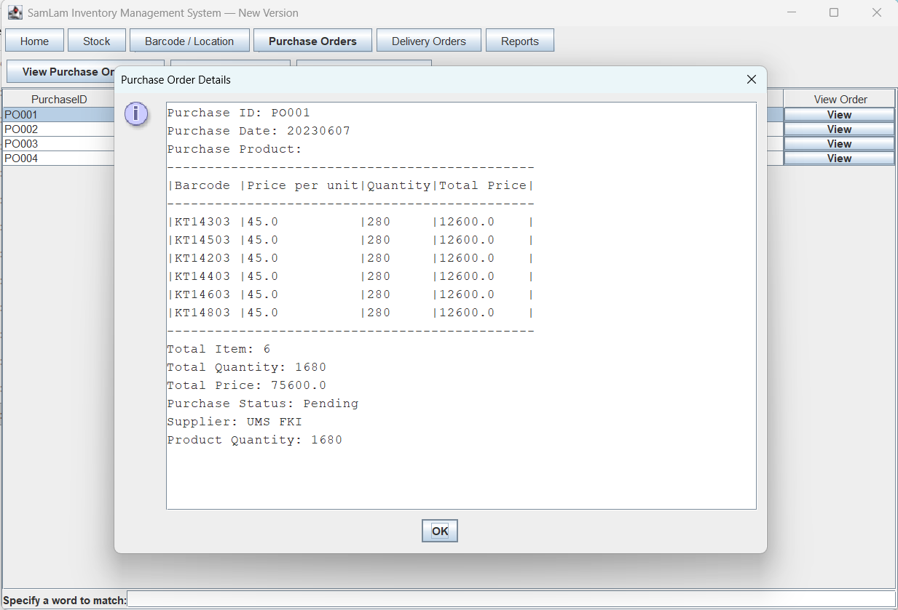
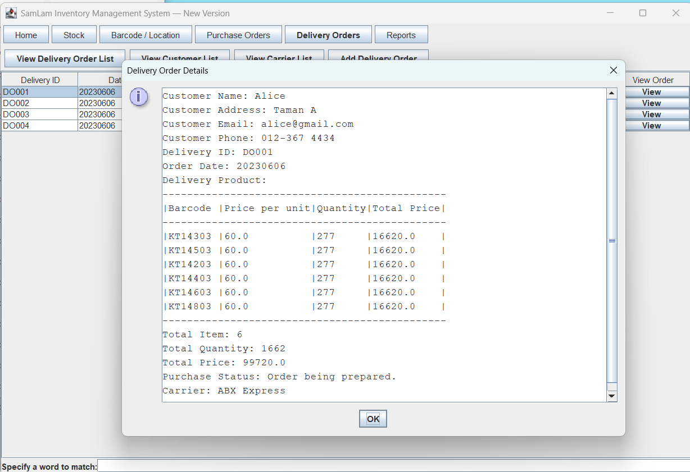

# Inventory Management System — Java OOP

A university **Object-Oriented Programming (OOP)** assignment built in Java, developed and owned entirely by **SamLam**. The project began in **IntelliJ IDEA** and can now be run from **Visual Studio Code** (or any terminal with a Java JDK). It contains the original object-oriented version, the original multi-window Swing desktop application, and an improved classic-style Swing application with two-row navigation.

> **Educational project:** This repository demonstrates Java/OOP concepts and a desktop inventory workflow. It is not a production-ready stock system.

## Versions at a glance

| Folder | What it shows | User interface |
| --- | --- | --- |
| [`IMS_OOD`](IMS_OOD/) | Original OOP implementation | Terminal output and `JOptionPane` input dialogs |
| [`IMS_GUI`](IMS_GUI/) | Original graphical implementation | Separate Java Swing windows |
| [`IMS_NEWVERSION`](IMS_NEWVERSION/) | Improved graphical implementation, keeping the classic original styling | One Swing window; first row for modules, second row for module actions; details below |

## Features

- Stock/product entry, inventory search, pricing, and quantities
- Product barcode and location lookup
- Purchase orders, supplier lists, and saved PO text records
- Delivery orders, customer/carrier lists, and saved DO text records
- Sales and analytics reporting
- Demonstration sign-up and login functionality

Some records in the example tables are **sample/demonstration data**, not a persistent database. Actual functionality varies by version.

## Requirements

- **JDK 17+** (tested locally with Eclipse Temurin Java 21)
- Windows, macOS, or Linux with a desktop display (Swing dialogs require a GUI session)
- Optional: **Visual Studio Code** with Microsoft's **Extension Pack for Java**

Check Java first:

```powershell
java -version
javac -version
```

## Running each version

Open the `inventory-management-system` folder in VS Code and choose **Terminal → New Terminal**. Run **one version at a time**. All commands below start at the repository root (`D:\inventory-management-system` if you extracted there). Each version uses its *own* `src` directory and *own* `out` folder.

### 1. IMS_OOD — original OOP version

```powershell
cd IMS_OOD
javac -d out src/*.java
java -cp out Main
```

The first prompt asks you to **Sign Up** or **Log In**. Input dialogs may open in separate windows, while some output appears in the terminal. To switch versions, stop the Java program (`Ctrl+C` in the terminal), then use `cd ..` to return to the repository root.

### 2. IMS_GUI — original multi-window Swing version

From the repository root:

```powershell
cd IMS_GUI
javac -d out src/*.java
java -cp out Main
```

After login, the original GUI opens different modules in separate windows. Order files are read/written relative to this folder under `PO/` and `DO/`.

### 3. IMS_NEWVERSION — improved classic Swing version

From the repository root:

```powershell
cd IMS_NEWVERSION
javac -d out src/*.java
java -cp out Main
```

After login, use the **top row** to choose Home / Stock / Barcode & Location / Purchase Orders / Delivery Orders / Reports; use the **second row** to select actions. Relevant forms and tables appear in the main workspace below. Purchase and delivery order **View** actions read local sample `.txt` records and display their contents in a scrollable dialog. Generated order files go in this version's `PO/` and `DO/` folders.

**Demo credentials (all versions, when using the prepared demo login):** Username `demo`, password `demo123`. These are public demo-only credentials; don't reuse them anywhere else. Authentication is basic/in-memory and not suitable for production.

**Note:** On Windows PowerShell, `javac -d out src/*.java` should work as shown. If a shell does not expand the wildcard, use an appropriate source-file listing for that shell. Running from each version directory is important because the code uses relative paths for order text files.

## Preview: improved GUI



| Inventory | Purchase orders | Delivery orders |
| --- | --- | --- |
|  |  |  |

More screenshots are available in [`docs/screenshots/ims-newversion`](docs/screenshots/ims-newversion/), [`docs/screenshots/original-gui`](docs/screenshots/original-gui/), and [`docs/screenshots/ood`](docs/screenshots/ood/). Full original UML diagram: [`docs/UML-diagram.pdf`](docs/UML-diagram.pdf).

## Project structure

```text
inventory-management-system/
├── IMS_OOD/src/             # Original object-oriented implementation
├── IMS_GUI/
│   ├── src/                 # Original multi-window Swing GUI
│   ├── PO/                  # Curated sample purchase orders
│   └── DO/                  # Curated sample delivery orders
├── IMS_NEWVERSION/
│   ├── src/                 # Improved GUI, classic styling
│   ├── PO/                  # Curated sample purchase orders
│   └── DO/                  # Curated sample delivery orders
├── docs/
│   ├── screenshots/         # All three versions
│   └── UML-diagram.pdf
├── .gitignore
└── README.md
```

## Sample records and data handling

The repository includes curated **PO001–PO004** and **DO001–DO004** `.txt` examples for each GUI edition (16 files total). Delivery samples use fictional demonstration contact information. Newly generated order `.txt` files are ignored by Git unless intentionally added; **review any new record for personal data before committing it**. No database server or network service is required for this project.

## OOP concepts demonstrated

The codebase includes classes representing users, administrators, stock, products/locations, suppliers, customers, carriers, purchase orders, and delivery orders. It uses constructors, encapsulated fields and methods, inheritance, and associations between domain objects. The [`UML diagram`](docs/UML-diagram.pdf) accompanies the design.

## Known limitations

- The project uses fixed example datasets and demonstration credentials; changes are not all persisted between sessions.
- Login/password handling is for education only and is not secure production authentication.
- Some Swing code uses legacy/raw generic types and may generate **unchecked-operation warnings** when compiled.
- The screenshots document manually captured UI states; they do not constitute complete automated end-to-end testing.
- The code is preserved as a university learning project rather than a fully refactored enterprise application.

## Ownership and development

**Designed, implemented, and maintained by SamLam.** This is an university OOP assignment. Developed originally with IntelliJ IDEA, then organized and tested using VS Code and JDK 21. `IMS_GUI` preserves the original GUI structure; `IMS_NEWVERSION` records subsequent improvements to navigation and usability.
